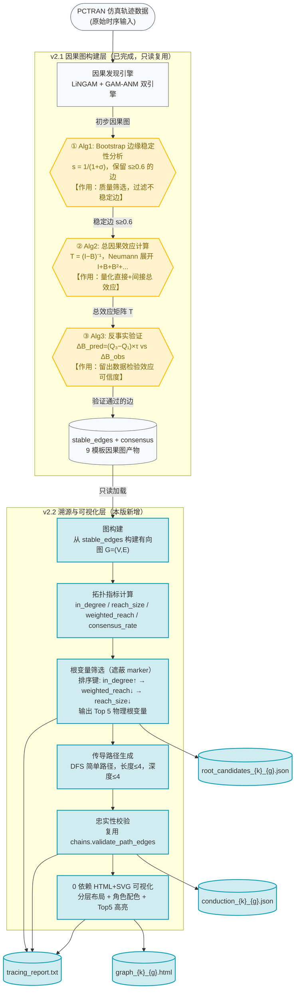

> **状态（2026-11-10）**：已被 `v2.3-final` 取代，溯源与可视化口径已按现行实现收敛至现行版（`NPPAD-CausalTrace-v2.3方案-12类全适配与变量选取机制.md`）§4.7；本文件仅作**归档**，保留不删。索引见 `方案/README.md`。

# NPPAD-CausalTrace v2.2 方案：变量溯源与因果图可视化

> **本版为 v2.1 之上的增量功能模块，当前唯一执行版本。** v2.1 已完成 9 模板因果图构建（LiNGAM+GAM 共识边、stable_edges、cL、frontier），本版在**不修改任何 v2.1 产物与代码**的前提下，新增两个能力：①基于因果图的变量溯源（定位顶层触发根变量）；②因果图完整结构可视化。
>
> **禁止事项**：不得重学因果图；不得修改 `consensus_*.json` / `gam_graph_*.json` / `signatures_*.json` / `chains.py` / `signatures.py` 等任何已有文件；不得实现 v3 方案。

## 1. 版本定位与边界

### 1.1 本版目标

在 v2.1 已训练因果图的基础上，实现**面向单事故场景的变量溯源与传导机制展示**：

1. **变量溯源**：从因果关系图中定位真正影响其他变量的**顶层触发根变量**（即因果链最上游节点，而非幅值最大或下游最多的节点）。示例：A→B,C；B→D,E,F；C→G,H → 根变量为 A（入度为 0 的最顶层节点），而非 B 或 C。
2. **因果图可视化**：以 0 依赖原生 HTML 展示因果图完整结构（全部节点与稳定边），并高亮溯源得到的根变量。
3. **传导链路输出**：从每个根变量出发，沿稳定边输出传导路径，按优先级排序。

### 1.2 与 v2.1 的关系

| 维度 | v2.1 | v2.2（本版） |
|---|---|---|
| 核心产出 | 9 模板因果图 + 事故类型判定 + RRF 传播链 | 根变量溯源 + 因果图可视化 + 传导链路 |
| 输入数据 | PCTRAN 仿真轨迹 | **仅复用 v2.1 已生成的因果图**（不重读原始轨迹） |
| 排序依据 | \|cL\| / \|cA\| 幅值（RRF） | **纯图拓扑**（入度、可达域、加权传导广度） |
| 是否重学图 | 是（LiNGAM+GAM） | **否**，只读 v2.1 产物 |
| marker 角色 | 根因链起点 | **遮蔽**：不参与根变量排名，仅作传导路径起点与注入源标注 |

### 1.3 决策记录（4 项）

1. **marker 处理 = 方案 B（遮蔽）**：根变量候选集 = V_graph \\ {marker}，marker 不参与根因排名；marker 节点保留在图中，仅作为"故障注入源"单独标注，并作为传导路径的展示起点。
2. **可视化 = 0 依赖原生 HTML**：仅用 Python 标准库生成内嵌 SVG+CSS 的 `.html`，不引入 networkx / graphviz / matplotlib 等任何第三方库。
3. **输出配置**：根变量默认输出 **Top 5**；传导路径最大长度 **4**；节点遍历深度上限 **4**。
4. **异常度 d(v) = 不引入**：溯源排序完全基于图拓扑结构，不使用 d(v)（z-score 幅值）作为排序依据。若需辅助信息，仅输出根变量下游的异常覆盖数作为附加字段，不影响排名。

### 1.4 业务数据流图

下图展示从原始数据到最终溯源输出的**完整数据流转全链路**。图中以六边形节点（带编号 ①②③）标注 CausalTrace 论文的三个核心算法模块，以虚线框区分 v2.1 已完成层与 v2.2 本版新增层。



**数据流说明**：

1. **输入层**：PCTRAN 仿真轨迹数据是整条链路的唯一原始输入。
2. **v2.1 因果图构建层**（已完成）：
   - 因果发现引擎（LiNGAM+GAM-ANM）从数据学出初步因果图
   - **① Alg1（Bootstrap 稳定性）**：对初步图做质量筛选，保留稳定边
   - **② Alg2（总因果效应）**：计算 T=(I−B)⁻¹，量化直接+间接效应
   - **③ Alg3（反事实验证）**：用留出数据检验效应可信度
   - 最终产出 `stable_edges` 与 `consensus`（9 模板）
3. **v2.2 溯源与可视化层**（本版新增）：
   - 只读加载 v2.1 的 `stable_edges` 构建有向图
   - 计算拓扑指标 → 筛选 Top 5 根变量（遮蔽 marker）→ 生成传导路径 → 忠实性校验 → 0 依赖 HTML 可视化
4. **输出层**：4 类产物（根变量 JSON、传导路径 JSON、可视化 HTML、汇总报告）

> 三个核心算法 ①②③ 的详细定义见第 11 节，与 CausalTrace 论文的对应关系见第 3.6 节。

## 2. 输入资产（只读复用 v2.1）

| 资产 | 路径 | 用途 |
|---|---|---|
| 稳定边 | `output/rca_v21/signatures_strict/signature_{k}_{g}.json` → `stable_edges` | 有向因果图 G 的边集 |
| 全部边 | 同上 → `all_edges` | 可选：边存在率统计 |
| marker 总效应列 | 同上 → `cL` | 仅作附加参考，不参与排序 |
| BFS 可达域 | 同上 → `frontier` | 校验与参考 |
| 共识分类 | `output/rca_v21/consensus_{k}_{g}.json` → `classification` | 边的 consensus/conflict/single_lingam 标签 |
| 变量集合 | `output/rca_v21/variable_sets.json` → `V_graph` | 节点集 |
| 实体表 | `rca/v21/knowledge.py:ENTITY_TABLE` | 变量中文名、子系统、单位 |

**模板覆盖**：3 类事故（LOCA/SGATR/FLB）× 3 严重度组（low/mid/high）= 9 模板。

## 3. 变量溯源算法

### 3.1 图构建

对每个模板 (k, g)，从 `stable_edges` 构建有向图 G = (V, E)：
- V = V_graph[k]（含 marker、WHPI、WECS，共 19 节点）
- E = stable_edges（f_e ≥ 0.70 且 dir_e ≥ 0.90 的有向边）

### 3.2 拓扑指标

对每个节点 v ∈ V，计算：

| 指标 | 定义 | 物理含义 |
|---|---|---|
| `in_degree(v)` | 指向 v 的稳定边数 | 有多少变量驱动 v；越小越接近顶层 |
| `out_degree(v)` | v 指出的稳定边数 | v 直接影响多少变量 |
| `reach(v)` | 从 v 出发沿有向边 BFS 可达的不同节点集合（不含 v 自身） | v 的传导广度 |
| `reach_size(v)` | \|reach(v)\| | 传导广度量化 |
| `weighted_reach(v)` | Σ_{u∈reach(v)} 1 / depth(v→u) | 近邻权重高的传导强度 |
| `consensus_rate(v)` | v 的出边中 label=consensus 的占比 | 出边可信度 |
| `depth(v)` | 从 marker 到 v 的 BFS 最短路径长度 | 距故障注入源的拓扑距离 |

### 3.3 根变量筛选（遮蔽 marker）

**根候选集**：C = V \\ {marker_k}（排除 marker，从物理变量中选根）。

**排序键**（严格拓扑，不使用任何幅值）：

```
sort_key(v) = ( in_degree(v) ASC,        # 第一键：入度升序 → 越顶层越优先
                weighted_reach(v) DESC,  # 第二键：加权传导广度降序
                reach_size(v) DESC,      # 第三键：可达域大小降序
                consensus_rate(v) DESC ) # 第四键：出边可信度降序
```

**为什么第一键是 in_degree**：顶层触发变量的本质是"不被其他变量驱动"（入度为 0 或极小）。在示例 A→B,C；B→D,E,F；C→G,H 中，A 的 in_degree=0，B、C 的 in_degree=1，因此 A 必然排在最前——这精确对应"最顶层触发变量"的定义。

### 3.4 根变量角色标注

根据拓扑位置标注每个根候选的角色：

| 角色 | 判定条件 | 说明 |
|---|---|---|
| `physical_root` | in_degree ≤ 1 的物理变量 | 物理根因层（最接近顶层） |
| `conduction_hub` | in_degree ≥ 2 且 out_degree ≥ 2 | 传导枢纽（承上启下） |
| `upstream_driver` | in_degree ≤ 1 且 out_degree ≥ 3 | 上游驱动节点 |
| `intermediate` | 其余 | 中间节点 |

### 3.5 tracing_score（辅助参考，不影响排序）

为提供可解释的数值参考，定义：

```
tracing_score(v) = weighted_reach(v) × consensus_rate(v)
```

该分数仅用于展示与跨模板对比，**不参与根变量排序**（排序键见 3.3）。

### 3.6 与论文算法的对应

本溯源建立在 CausalTrace 论文三大核心算法产出的因果图之上，对应关系如下：

| 论文算法 | 在 v2.1 中的产出 | v2.2 溯源如何使用 |
|---|---|---|
| **① Alg1：Bootstrap 边缘稳定性分析** | `stable_edges`（f_e ≥ 0.70 且 dir_e ≥ 0.90 的稳定边） | 作为有向图 G 的**唯一边集**，溯源只在稳定边上进行 |
| **② Alg2：总因果效应计算 T=(I−B)⁻¹** | `cL`（marker 总效应列）、边强度 | 仅作附加参考字段（`consensus_rate`），**不参与排序** |
| **③ Alg3：反事实验证** | `consensus` 边的验证可信度（consensus/conflict/single_lingam 标签） | 用于 `consensus_rate(v)` 加权与可视化边着色 |

**根因定位逻辑**：本版溯源不重新计算因果效应，而是在 Alg1 筛选出的稳定图上做**拓扑反溯**——以 `in_degree`（入度最小=最顶层）为第一排序键，定位不被其他变量驱动的上游触发节点。这对应论文中"因果上游异常源"的拓扑实现，但排序依据严格为图结构而非效应幅值。

> 三个算法的完整定义见第 11 节。本方案所有算法理论均来自 CausalTrace 论文 (AAAI-26)，详见第 12 节参考文献。

## 4. 因果图可视化

### 4.1 技术选型

**0 依赖原生 HTML**：仅使用 Python 标准库（`json`、`html`、`pathlib`）生成 `.html` 文件，内嵌 SVG + CSS。浏览器直接打开，无需安装任何库。

### 4.2 布局策略

- **分层布局**：按 `depth(v)`（从 marker 出发的 BFS 深度）横向分层，marker 在最左（第 0 层），末端症状在最右。
- **同层节点**：按变量名字典序纵向排列。
- **边**：贝塞尔曲线连接，从左指向右。

### 4.3 视觉编码

| 元素 | 编码规则 |
|---|---|
| 节点颜色 | marker=红（#e74c3c）；physical_root=橙（#e67e22）；conduction_hub=蓝（#3498db）；其余=灰（#95a5a6） |
| 节点边框 | Top 5 根变量加粗 + 阴影高亮 |
| 节点文字 | 变量名 + 中文名（ENTITY_TABLE） |
| 边颜色 | consensus=黑（#2c3e50）；conflict=红虚线（#e74c3c dashed）；single_lingam=灰（#bdc3c7） |
| 边标注 | `f_e`（边存在率），hover 显示 dir_e 与权重 |
| 边粗细 | 与 f_e 成正比 |

### 4.4 交互（纯 CSS/JS，0 依赖）

- 节点 hover：显示完整实体信息（子系统、单位、in_degree、out_degree、reach_size、tracing_score）
- 边 hover：显示 from→to、f_e、dir_e、consensus 标签
- 点击节点：高亮其所有出边与下游节点（纯 CSS `:target` 或内联 JS，无第三方库）

## 5. 传导链路输出

### 5.1 路径生成

对每个 Top 5 根变量 r，从 r 出发沿 stable_edges 做 DFS，生成所有**简单路径**（无重复节点），满足：
- 路径长度（边数）≤ 4
- 路径深度（节点数）≤ 5
- 路径终点为 out_degree=0 的末端症状（或达到深度上限）

### 5.2 路径排序

对同一根变量的多条路径，按以下键排序：
1. 路径上 consensus 边数降序（可信度高的路径优先）
2. 路径长度降序（传导链长者优先，展示更完整）
3. 路径首字母升序（确定性）

### 5.3 忠实性校验

每条路径的每条边必须 ∈ stable_edges。复用 `rca/v21/chains.py:validate_path_edges`（import 调用，不修改）。不通过的路径从输出中剔除，并在报告中记录剔除数。

## 6. 输出规范

所有产物输出至 `output/rca_v21/tracing/`，与原 `chains/`、`signatures_strict/` 隔离。

### 6.1 root_candidates_{k}_{g}.json

```json
{
  "schema": "NPPAD-CausalTrace-v2.2-tracing",
  "template": {"k": "LOCA", "g": "high", "marker": "WLR"},
  "graph_summary": {
    "n_nodes": 19,
    "n_stable_edges": 55,
    "n_consensus": 42,
    "n_conflict": 11
  },
  "root_candidates": [
    {
      "rank": 1,
      "variable": "LVPZ",
      "entity": {"meaning": "稳压器水位", "subsystem": "一回路热工", "unit": "%"},
      "role": "physical_root",
      "in_degree": 0,
      "out_degree": 8,
      "reach_size": 15,
      "weighted_reach": 12.5,
      "consensus_rate": 1.0,
      "tracing_score": 12.5,
      "is_marker": false
    },
    {"rank": 2, "variable": "VOL", "...": "..."},
    {"rank": 3, "variable": "WFWA", "...": "..."},
    {"rank": 4, "variable": "WSTA", "...": "..."},
    {"rank": 5, "variable": "P", "...": "..."}
  ],
  "marker_info": {
    "variable": "WLR",
    "role": "injection_source",
    "note": "故障指示器，遮蔽不参与根因排名；传导路径展示起点"
  },
  "method_note": "排序键=(in_degree ASC, weighted_reach DESC, reach_size DESC, consensus_rate DESC); 不使用|cL|/|cA|/d(v)"
}
```

### 6.2 conduction_{k}_{g}.json

```json
{
  "schema": "NPPAD-CausalTrace-v2.2-conduction",
  "template": {"k": "LOCA", "g": "high", "marker": "WLR"},
  "conduction_paths": [
    {
      "root": "LVPZ",
      "root_role": "physical_root",
      "path": ["LVPZ", "P", "WHPI", "WECS"],
      "length": 3,
      "edges": [
        {"edge": "LVPZ->P", "f_e": 0.99, "dir_e": 1.0, "consensus": "consensus"},
        {"edge": "P->WHPI", "f_e": 1.0, "dir_e": 1.0, "consensus": "consensus"},
        {"edge": "WHPI->WECS", "f_e": 1.0, "dir_e": 1.0, "consensus": "consensus"}
      ],
      "consensus_count": 3,
      "grounded": true
    }
  ],
  "faithfulness": {
    "total_paths": 12,
    "grounded_paths": 12,
    "ungrounded_count": 0
  }
}
```

### 6.3 graph_{k}_{g}.html

独立 HTML 文件，内嵌完整 SVG 图（见第 4 节）。

### 6.4 tracing_report.txt

9 模板汇总报告，结构：

```
================================================================================
NPPAD-CausalTrace v2.2 变量溯源与因果图可视化 汇总报告
================================================================================

一、LOCA
  1. LOCA_high
     Top 5 根变量：1) LVPZ(physical_root) 2) VOL(physical_root) 3) WFWA(conduction_hub) ...
     传导链路示例：LVPZ → P → WHPI → WECS
     图文件：graph_LOCA_high.html
  2. LOCA_mid ...
  3. LOCA_low ...

二、SGATR ...
三、FLB ...

================================================================================
验证：忠实性校验全部通过（0 ungrounded）；排序键纯拓扑（in_degree 优先）
================================================================================
```

## 7. 验证方案

| # | 验证项 | 方法 | 通过标准 |
|---|---|---|---|
| V1 | 核心因果关系完整性 | 传导路径边逐条校验 ∈ stable_edges | ungrounded_count = 0 |
| V2 | 溯源逻辑非幅值 | 断言：Top 5 根变量的 \|cL\| 排名 ≠ 根变量排名 | 不一致 |
| V3 | 顶层优先 | 断言：Top 1 根变量 in_degree ≤ 所有其他物理节点 in_degree | 成立 |
| V4 | marker 遮蔽 | 断言：root_candidates 中不含 marker | 不含 |
| V5 | 可视化完整 | 断言：HTML 节点数 = \|V_graph\|，边数 = \|stable_edges\| | 相等 |
| V6 | 路径长度约束 | 断言：所有路径 length ≤ 4，节点数 ≤ 5 | 成立 |
| V7 | 不污染原产物 | 校验原 `chains/`、`signatures_strict/`、`consensus_*.json` 的 mtime 不变 | 不变 |

## 8. 目录与文件组织

```
CausalTrace/Code/
├── rca/v21/
│   ├── source_tracing.py        # 【新增】溯源算法（纯函数）
│   ├── graph_visualization.py   # 【新增】HTML/SVG 可视化（0 依赖）
│   └── run_source_tracing.py    # 【新增】执行器
└── output/rca_v21/
    └── tracing/                 # 【新增】
        ├── root_candidates_LOCA_high.json   (×9)
        ├── conduction_LOCA_high.json        (×9)
        ├── graph_LOCA_high.html             (×9)
        └── tracing_report.txt
```

**现有文件全部只读，不修改**。新增文件仅 3 个 `.py`，输出仅在 `tracing/` 子目录。

### 8.1 模块职责

| 模块 | 职责 | 依赖 |
|---|---|---|
| `source_tracing.py` | 拓扑指标计算、根变量筛选排序、传导路径生成、忠实性校验 | `knowledge.py:ENTITY_TABLE`、`chains.py:validate_path_edges` |
| `graph_visualization.py` | 生成 HTML+SVG 图 | 无第三方库 |
| `run_source_tracing.py` | 加载 9 模板 → 调用溯源+可视化 → 写产物+报告 | 上述两个模块 |

## 9. 不做的事

- ❌ 不实现变量匹配/分类（E1/E2/E3、fusion、abstain 全部不涉及）
- ❌ 不重学因果图（LiNGAM/GAM 不再运行）
- ❌ 不实现 v3 方案
- ❌ 不修改任何现有 `.py` / `.json` 文件
- ❌ 不引入任何第三方可视化库
- ❌ 不使用 \|cL\|、\|cA\|、d(v) 等幅值作为排序依据

## 10. 执行步骤

1. 新增 `source_tracing.py`：实现拓扑指标、根变量筛选、传导路径、忠实性校验
2. 新增 `graph_visualization.py`：实现 0 依赖 HTML+SVG 生成
3. 新增 `run_source_tracing.py`：编排 9 模板执行
4. 运行执行器，生成 9×3 产物 + 汇总报告
5. 按 V1~V7 验证
6. 人工抽检 LOCA_high 的根变量与传导链路物理合理性

## 11. 三个核心算法模块定义（来自 CausalTrace 论文）

本节定义数据流图中标注的三个核心算法 ①②③。三者构成"发现 → 筛选 → 量化 → 验证"的因果分析流水线，本版溯源直接复用其产出，不重新实现。

### 11.1 ① Algorithm 1：Bootstrap 边缘稳定性分析

| 项 | 说明 |
|---|---|
| **定位** | 因果图质量控制（筛选环节） |
| **目标** | 过滤掉不稳定的因果边，保留高可信度边 |
| **核心公式** | 稳定性分数 `s = 1 / (1 + σ)`，其中 σ 是 bootstrap 样本中该边因果强度的标准差 |
| **步骤** | ① 对数据集有放回重采样 N 次；② 每次跑因果发现得到 G^(i)；③ 记录每条边的强度 w_i；④ 计算 σ 与 s；⑤ 保留 s ≥ 阈值的边 |
| **阈值** | s ≥ 0.6（本项目 v2.1 采用 f_e ≥ 0.70 且 dir_e ≥ 0.90 的等价稳定边筛选） |
| **v2.2 用途** | 其产出 `stable_edges` 是溯源有向图 G 的**唯一边集** |

### 11.2 ② Algorithm 2：总因果效应计算

| 项 | 说明 |
|---|---|
| **定位** | 因果效应量化环节 |
| **目标** | 把因果图从"有没有关系"升级为"关系有多大"，计算任意两变量间的总效应（直接+间接） |
| **核心公式** | 总因果效应矩阵 `T = (I − B)⁻¹`，其中 B 为直接效应矩阵 |
| **Neumann 展开** | `T = I + B + B² + B³ + ...`，I=自身效应，B=直接效应，B^k=k 跳间接效应 |
| **数学前提** | DAG 中 B 为严格三角矩阵，谱半径为 0，级数必然收敛 |
| **v2.2 用途** | 其产出 `cL`（marker 总效应列）仅作附加参考字段，**不参与根变量排序** |

### 11.3 ③ Algorithm 3：反事实验证

| 项 | 说明 |
|---|---|
| **定位** | 因果效应自验证环节 |
| **目标** | 用留出数据（held-out data）检验学出的因果效应是否可信 |
| **核心逻辑** | 比较模型预测的变化与数据中实际观测到的变化，误差越小越可信 |
| **核心公式** | `ΔB_pred = (Q₃(A) − Q₁(A)) × τ_A→B`；`ΔB_obs = E[B|A≈Q₃] − E[B|A≈Q₁]`；`Error = |ΔB_pred − ΔB_obs|` |
| **方法** | 准实验（用观测数据的 Q₁/Q₃ 自然分组近似干预，非真实 RCT） |
| **v2.2 用途** | 其产出的边验证标签（consensus/conflict/single_lingam）用于 `consensus_rate` 加权与可视化着色 |

### 11.4 三算法串联关系

```
原始数据 → 因果发现(LiNGAM+GAM) → ①Alg1筛选(稳定边) → ②Alg2量化(T矩阵) → ③Alg3验证(可信度)
                                                          ↓
                                              stable_edges + consensus
                                                          ↓
                                              v2.2 溯源与可视化（本版）
```

记忆口诀：**Alg1=筛选，Alg2=量化，Alg3=验证**。

## 12. 参考文献

本方案所有因果分析理论与算法均来自以下唯一指定文献：

[1] **CausalTrace: A Neurosymbolic Causal Analysis Agent for Smart Manufacturing** (AAAI-26)

> 本方案不引用其他任何文献。三个核心算法（Algorithm 1/2/3）的定义、公式与串联关系均严格依据该论文及其学习笔记（阶段 1~3）整理。
